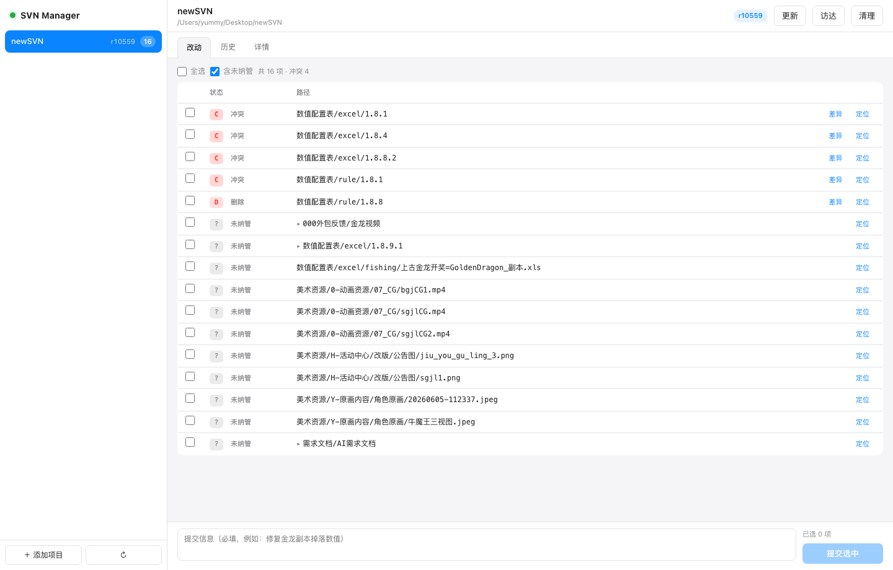

# SVN Manager

一个免费的、macOS 上的多项目 Subversion 图形客户端。



## 为什么做这个

macOS 上最好用的 SVN 客户端是 [SnailSVN](https://apps.apple.com/cn/app/id1063090543)，它和访达（Finder）深度集成，右键就能提交。

但**免费的精简版只支持一个工作副本**。同一台机器上管理多个 SVN 项目，就得反复在偏好设置里换路径，或者买专业版。

而 macOS 上完全没有其它免费的替代品：

| 工具 | 支持多项目 | 免费 | 现状 |
|---|---|---|---|
| SnailSVN 精简版 | ❌ 只能 1 个 | ✅ | 够用但被卡住 |
| SnailSVN 专业版 | ✅ | ❌ 付费 | 唯一体验好的选择 |
| SmartSVN | ✅ | ❌ | 14.3 起商业用途必须付费 |
| svnX | ✅ | ✅ | 开源，但 2016 年后没更新，新系统跑不起来 |
| Cornerstone / Versions | ✅ | ❌ | 付费 |
| TortoiseSVN | — | — | 只有 Windows 版 |

GitHub 上搜到的几个「macOS SVN 客户端」基本都是没有可运行发布物的空壳仓库。

所以这里是一个能用的：**零依赖、单文件、调用系统 `svn` 命令行**的图形界面。

## 功能

- **多项目侧栏**，项目数量无限制，每个显示当前版本号和改动数
- **改动列表**：状态徽章（`C` 冲突 / `M` 修改 / `A` 新增 / `D` 删除 / `?` 未纳管 / `!` 缺失），逐文件查看差异、定位到访达
- **勾选 + 写提交信息 → 提交**，未纳管文件可自动 `svn add`
- **历史时间线**：版本号、作者、时间、提交信息、改动路径
- **详情**：仓库 URL、UUID、最后修改者、最后修改版本
- **一键更新 / 清理（cleanup）**
- 跟随系统深色 / 浅色模式

## 安装

需要 macOS + 已经装好 `svn` 命令行：

```bash
brew install subversion
```

然后：

```bash
git clone https://github.com/akuwa666/svn-manager-mac.git
cd svn-manager-mac
./install.sh
```

装到 `~/Applications/SVN Manager.app`，双击即可打开。

> 也可以用 `python3 svnmanager.py` 直接跑，不用装 App。

## 使用

1. 双击打开，左下角 **＋ 添加项目**
2. 点 **浏览…** 选目录，认到 `.svn` 的那一层会标绿
3. 左侧切换项目，右侧勾选要提交的文件，写提交信息，点 **提交选中**

项目列表存在 `~/.svnmanager.json`，可以直接编辑：

```json
{
  "projects": [
    { "name": "客户端", "path": "/Users/you/Desktop/client" },
    { "name": "配置表", "path": "/Users/you/Desktop/config" }
  ]
}
```

## 工作原理

一个单文件 Python 程序（只用标准库）：

- 起一个只监听 `127.0.0.1:8765` 的 HTTP 服务
- 对内嵌的单页前端提供 JSON 接口
- 每个操作都转成一条 `svn` 命令（`status` / `update` / `commit` / `log` / `diff` / `cleanup` / `resolve`）
- 用 Chrome 的 `--app` 模式打开，没有地址栏，观感接近原生窗口

因为核心就是调用命令行 `svn`，所以任何 `svn` 能做的事它都能做，认证、`svn://`、`svn+ssh://`、`http(s)://` 全都沿用系统的凭据缓存。

## 常见问题

**Q：会不会覆盖或丢失我的改动？**
不会。所有写操作都是标准的 `svn commit` / `svn update`，`svn update` 用 `--accept postpone`，遇到冲突会停下来而不是替你选。

**Q：出现「树冲突：本地目录删除，incoming dir delete」怎么办？**
这通常是因为在访达里直接删了 SVN 管理的目录，而服务器上也删了。两边目标一致，直接：

```bash
svn resolve --accept working <路径>
```

**Q：`svn status` 显示 `!` 缺失 / `C` 冲突，能在这里处理吗？**
能看状态和差异，但解决冲突目前建议用命令行。`svn resolve --accept working` 是"保留我本地状态"的通用解法。

**Q：为什么不是访达扩展（没有图标角标和右键菜单）？**
访达扩展（Finder Sync Extension）需要 Xcode 开发和代码签名，个人分发基本跑不起来。这个工具走的是独立窗口路线。

**Q：端口被占用 / 打不开？**
默认 `8765`，可以 `python3 svnmanager.py --port 9000`。

## 已知限制

- 没有文件级的「删除」按钮（走 `svn delete`），目前删除需要命令行或其它客户端
- 没有 `blame`、`merge`、分支切换
- 差异查看只对文本文件有意义（二进制文件只会显示一行提示）

## License

MIT
